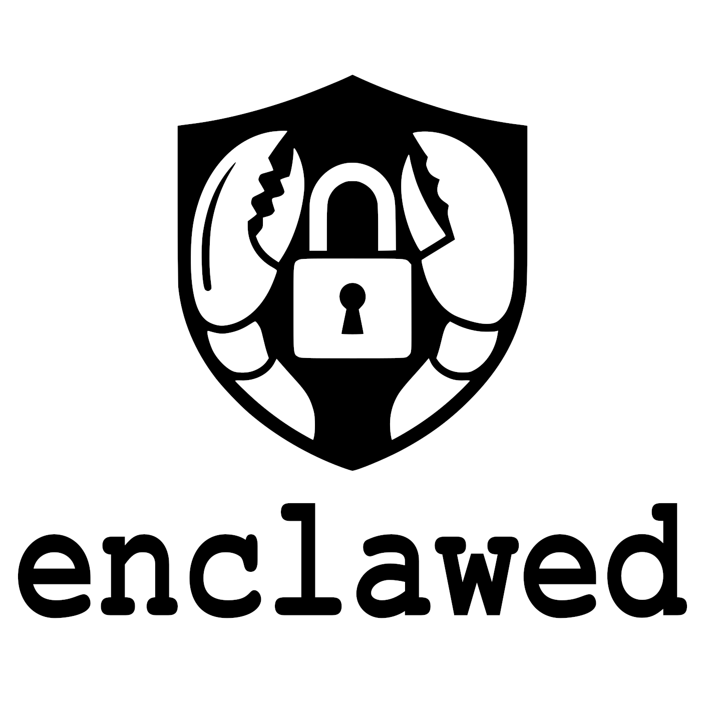

<p align="center">
  
</p>

# Enclawed

**AI agent security that prompt injection can't break.**

Enclawed runs AI agents (in chat apps, in your terminal, across a cluster) and puts every action they take through fixed rules before it runs. A model can be talked into anything; the rules can't. An injected instruction gets exactly as far as the rules allow, every decision lands in a tamper-evident log, and starting a session takes your security key.

## Built for HPC clusters and agent swarms

The same rules hold from one laptop to a supercomputer. New in Enclawed 2.0: agent swarms. `enclawed swarm` runs high-performance computing (HPC) jobs and swarms of agents across many machines, and the architecture is made for extreme-scale computing: every rank is supervised on its own node and every node signs with its own key, so the protection grows with the cluster.

- **Every launch decided by policy.** MPI (Message Passing Interface), Slurm, PBS/Moab and Flux launches, including those inside wrappers, scripts and `ssh`, are allowed or refused by policy alone, and a launch command Enclawed cannot fully parse is refused.
- **Every rank supervised for the whole run.** Ranks hold short leases renewed by signed heartbeats; a rank whose lease lapses is paused, a tampered one is killed, and coordinators evict on evidence.
- **Science runs at full speed.** On a 16-rank LAMMPS molecular-dynamics job, on CPUs and GPUs, supervision leaves the compute loop unchanged and adds about 3 seconds at start-up.
- **Drops into the cluster you have.** No administrator privileges and no changes to the cluster: Enclawed connects over Secure Shell (SSH) alone.
- **Holds under attack.** Twelve live attacks on hardware-keyed ranks, colluding coordinators included, all ended fail-closed; 16 agents on a real model attempted 24 launches that planted instructions ordered, and all 24 were denied while all 108 legitimate launches went through.

We have run 16 ranks so far; larger-scale runs are in the pipeline. Design, attacks and measurements: [arXiv:2610.33318](https://arxiv.org/abs/2610.33318) ([doi.org/10.5281/zenodo.23602948](https://doi.org/10.5281/zenodo.23602948)); everything behind the numbers is reproducible from [hpc-agentic-swarm-reproduction](https://github.com/enclawed/hpc-agentic-swarm-reproduction).

## What you get

Out of the box:

- **Rules decide, not the model.** Every tool call goes through Enclawed's checks before it runs, and what the model says about its own request counts for nothing.
- **Secrets stay put.** Outbound content carrying a credential or another protected value is blocked, and hidden characters are stripped before anything leaves.
- **A record nobody can quietly edit.** Every decision goes into a hash-chained audit log you can verify at any time (`enclawed audit`).
- **Your key, not a password.** Starting a session, changing policy and turning off a protection all take a FIDO2 (Fast IDentity Online) security key or this computer's device-bound passkey (`enclawed auth enroll`). There is no switch that turns this off.
- **Tools you admitted, not tools that changed.** An MCP (Model Context Protocol) server is admitted only with a valid signed clearance statement, and a tool whose definition changes after admission is refused until you admit it again.
- **Optional hardware root.** With an Enclaweder device, the authority lives in hardware: even root on the machine cannot silently alter the log, forge an agent's actions or take its secrets.
- **Works with what you use.** Telegram, Discord, Slack, WhatsApp, Signal, Microsoft Teams, Matrix and more; local models (Ollama, vLLM, LM Studio) and the major cloud providers.
- **Check it yourself.** `enclawed conformance` verifies the security guarantees on your installation, one line per guarantee.

Turn on **enclaved mode** (`ENCLAWED_FLAVOR=enclaved`, or an administrator's policy) for deployments that cannot take chances. It needs Node.js running with a FIPS-enabled OpenSSL, and adds:

- **Deny by default.** Only allowlisted channels, model providers, tools and network hosts work.
- **A person approves what cannot be undone.** Changes that can be reversed go ahead and keep a history you can restore (`enclawed history`); actions that cannot be undone wait for your approval.
- **No record, no action.** A call does not run while the audit log cannot record it.
- **Signed code only.** Every module must carry a valid signature from a signer you trust; unsigned modules do not load.

## Install

Requires Node.js 22.14 or later.

```bash
npm install -g enclawed
```

## Quick start

```bash
enclawed auth enroll --label primary      # your security key (or: --passkey --label laptop)
enclawed onboard                          # gateway, workspace, models and channels
enclawed conformance                      # verify the guarantees on this machine
enclawed doctor                           # health checks and quick fixes
```

`enclawed --help` lists every command. Documentation: [`docs/`](https://github.com/enclawed/enclawed-oss/tree/main/docs).

## Using Claude Code?

[Enclawed Code](https://github.com/enclawed/enclawed-code) runs Claude Code with every tool call decided by Enclawed: `npm install -g enclawed-code`, then type `ecwcode` where you would type `claude`.

## About

Enclawed is built by [Enclawed, Inc.](https://enclawed.com) It began as a fork of [OpenClaw](https://github.com/openclaw/openclaw) and adds the deterministic security layer described above.

## License

MIT. See [`LICENSE`](LICENSE).
